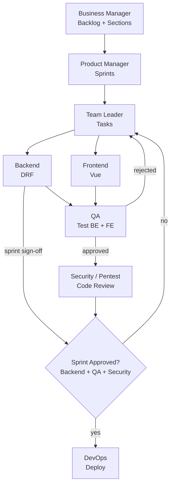

# Agents

This folder defines the AI agent team that builds the project end to end. Each agent has its own file with a clear role, inputs, outputs, and rules. Agents never skip their stage. Work moves forward only through **written handoff files** in `docs/`, so every decision is traceable.

## Stack

| Layer    | Technology                              |
|----------|-----------------------------------------|
| Backend  | Django + Django REST Framework (DRF)    |
| Frontend | Vue 3 (Composition API), Vite, Pinia    |
| Testing  | pytest / pytest-django, Vitest, Playwright |
| DevOps   | Docker, docker-compose, CI/CD pipeline  |

## The Team

| Agent | File | Responsibility |
|-------|------|----------------|
| Business Manager | `business_manager.md` | Builds the full project backlog and splits it into sections (epics) |
| Product Manager | `product_manager.md` | Plans sprints from the backlog |
| Team Leader | `team_leader.md` | Breaks each sprint into tasks and assigns them |
| Backend | `backend.md` | Implements DRF APIs, models, and backend tests |
| Frontend | `frontend.md` | Implements Vue UI and connects it to the API |
| QA | `qa.md` | Tests backend + frontend output and approves or rejects |
| Security / Pentest | `security_pentest.md` | Reviews code and runs web penetration tests |
| DevOps | `devops.md` | Builds and deploys after the sprint is approved |

## Workflow



1. **Business Manager** writes the complete backlog and groups it into sections (epics).
2. **Product Manager** turns sections into ordered sprints with goals and scope.
3. **Team Leader** splits each sprint into backend, frontend, and QA tasks with acceptance criteria and dependencies.
4. **Backend** and **Frontend** implement their tasks. Backend publishes the API contract first so Frontend can build against it.
5. **QA** tests the output of both Backend and Frontend. Failed tasks go back to the Team Leader as bugs.
6. **Security / Pentest** reviews the sprint's code and runs web penetration tests. Critical or High findings block the release.
7. **Sprint approval** requires sign-off from **Backend** and **QA** (and no blocking security findings).
8. **DevOps** pulls the approved code, builds, and deploys.

## Handoff Files

All agents communicate through these files. An agent reads its inputs, writes its outputs, and never edits another agent's output except to append status updates.

```
docs/
├── backlog/
│   └── BACKLOG.md                  # Business Manager
└── sprints/
    └── sprint-01/
        ├── SPRINT.md               # Product Manager
        ├── API_CONTRACT.md         # Backend (read by Frontend + QA)
        ├── tasks/
        │   ├── TASK-001.md         # Team Leader (status updated by assignee)
        │   └── ...
        ├── QA_REPORT.md            # QA
        ├── SECURITY_REPORT.md      # Security / Pentest
        ├── APPROVAL.md             # Backend + QA sign-off
        └── DEPLOY_LOG.md           # DevOps
```

## ID Conventions

| Item | Format | Example |
|------|--------|---------|
| Section (epic) | `SEC-XX` | `SEC-02` |
| Backlog item | `BL-XXX` | `BL-014` |
| Sprint | `sprint-XX` | `sprint-03` |
| Task | `TASK-XXX` | `TASK-027` |
| Bug | `BUG-XXX` | `BUG-005` |
| Security finding | `VULN-XXX` | `VULN-002` |

## Task Status Lifecycle

```
TODO → IN_PROGRESS → IN_REVIEW → IN_QA → DONE
                                     ↘ REJECTED → (back to IN_PROGRESS)
```

## Global Rules for All Agents

- Read your input files before doing anything. If an input is missing or unclear, stop and report it instead of guessing.
- Stay inside your role. Backend does not edit Vue files; Frontend does not edit Django files; QA does not fix code.
- Every output file uses the template in your agent file.
- Reference IDs (`BL-`, `TASK-`, `BUG-`) everywhere so work is traceable from backlog to deployment.
- Never commit secrets, credentials, or `.env` files.
- Nothing is deployed without an approved `APPROVAL.md`.
